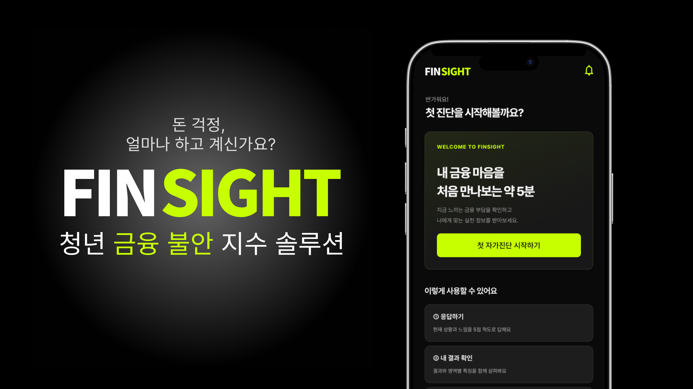
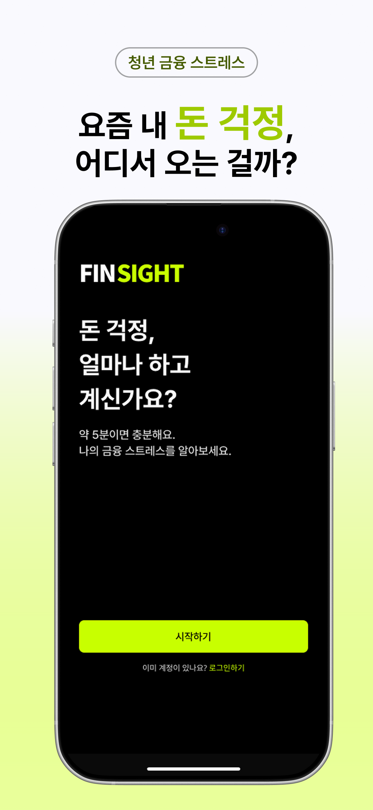
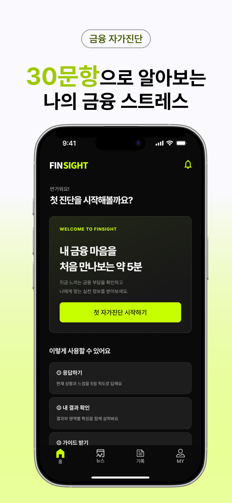
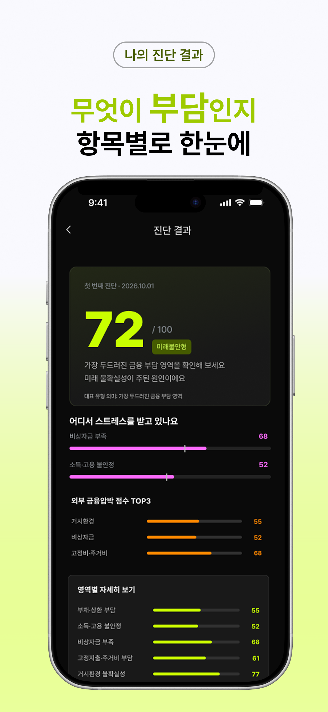
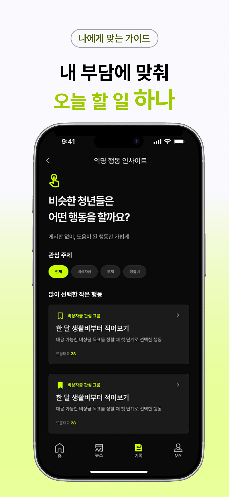
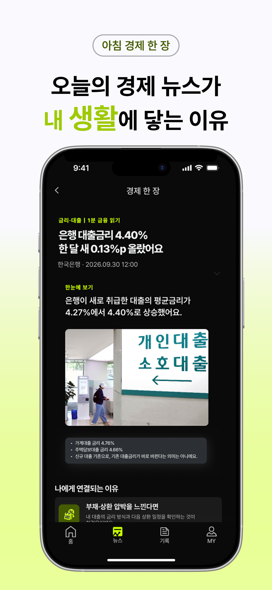
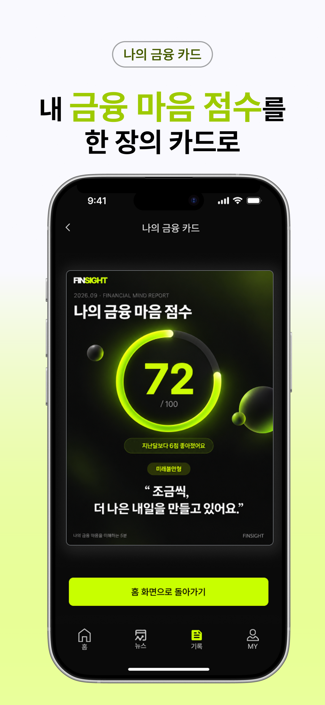

# 핀사이트 · FINSIGHT

> 돈 걱정이 어디서 오는지 알아보는 약 5분

핀사이트는 대학생과 사회초년생 등 청년을 위한 금융 스트레스 자가점검 앱입니다. 30개 질문에 답하면 지금 느끼는 금융 부담을 항목별로 살펴보고, 내 상황에 맞는 작은 실천을 확인할 수 있습니다. 지난 점검 기록을 돌아보며 내 금융생활의 변화도 살펴볼 수 있습니다.

[App Store에서 다운로드](https://apps.apple.com/kr/app/id6834777921)

## 서비스 개요

| 핵심 기능 | 사용 방법 |
| --- | --- |
| 금융 스트레스 자가점검 | 약 5분 동안 30개 질문에 답하며 현재의 금융 부담과 돈 관리 습관을 돌아봅니다. |
| 항목별 결과 | 100점 만점의 금융 스트레스 점수와 함께 대출·카드 상환, 소득·고용, 비상금, 고정지출·주거비, 미래 경제 상황, 가족 지원 비용 중 어떤 부분이 부담인지 확인합니다. |
| 맞춤 실천 가이드 | 응답에 따라 자동결제 목록 확인하기, 한 달 생활비 적어보기 등 오늘 할 일과 다음 단계를 안내받습니다. |
| 경제 한 장 | 경제 뉴스의 핵심과 내 생활에 연결되는 이유, 확인해볼 행동을 함께 읽습니다. |
| 기록과 금융 카드 | 지난 점검 결과와 변화를 돌아보고, 나의 금융 마음 점수를 한 장의 카드로 확인합니다. |

자가점검 결과는 금융생활을 이해하고 돌아보기 위한 참고 정보입니다.

## 앱 화면

| 시작하기 | 30문항 자가점검 | 항목별 진단 결과 |
| :---: | :---: | :---: |
|  |  |  |

| 작은 실천과 행동 인사이트 | 경제 한 장 | 나의 금융 카드 |
| :---: | :---: | :---: |
|  |  |  |

위 이미지는 핀사이트의 기능을 소개하는 앱 미리보기입니다. 화면 속 점수, 날짜, 뉴스와 반응 수 등은 예시이며 실제 이용 시 표시되는 내용과 다를 수 있습니다.

## 프로젝트 구성

| 저장소 | 역할 | 기술 |
| --- | --- | --- |
| [frontend](https://github.com/finsight-2026/frontend) | 사용자 앱 UI, 자가점검, 결과·가이드·뉴스·기록 및 금융 카드 | Flutter, Dart |
| [backend](https://github.com/finsight-2026/backend) | 인증과 설문 API, 금융 스트레스 점수 산출, 진단 기록 및 콘텐츠 제공 | Java, Spring Boot, PostgreSQL |
| [frontend-admin](https://github.com/finsight-2026/frontend-admin) | 사용자·콘텐츠 관리 및 서비스 운영 현황 확인을 위한 관리자 웹 | React, TypeScript, Vite, Ant Design |
| [infra](https://github.com/finsight-2026/infra) | 개발·운영 환경의 인프라 구성 | Docker Compose |

## 문의

[emfpdlzj@gmail.com](mailto:emfpdlzj@gmail.com)
